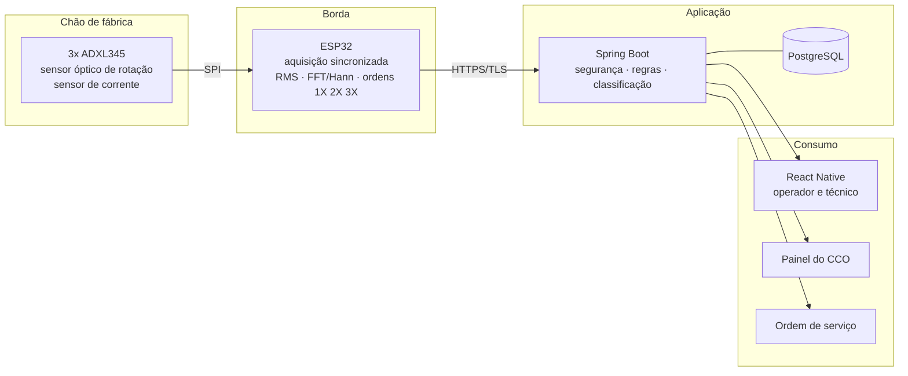

# PredictSpin

Monitoramento de condição por vibração multiponto em máquinas rotativas industriais.

Do acelerômetro na máquina à ordem de serviço no Centro de Controle Operacional — um método de
instrumentação e uma plataforma IIoT de ponta a ponta.

## Contexto

O projeto nasceu de uma demanda real da GEOSOL — Geologia e Sondagens S/A, empresa que hoje troca
componentes de sonda de perfuração por tempo de uso, não por condição real do equipamento. A
proposta é substituir manutenção por calendário por manutenção orientada por dado: instrumentar a
máquina com acelerômetros, extrair características do sinal de vibração e transformar isso em
alerta e ordem de serviço, antes da falha acontecer.

O método core do projeto separa, na vibração medida, o que vem do acionamento (motor) daquilo que
vem da interação entre ferramenta e material — o que permite diagnosticar não só se há um problema,
mas se ele está no equipamento ou no processo. A validação é feita em máquinas rotativas reais do
laboratório de mecânica do SENAI (torno e furadeira de coluna), com a sonda de perfuração da
GEOSOL como caso de aplicação de referência.

## Arquitetura



Detalhes de cada camada, fluxo de ingestão e decisões estruturais estão em [`docs/arquitetura.md`](docs/arquitetura.md).
O modelo de dados está em [`docs/der.md`](docs/der.md).

## Stack

- **Borda:** ESP32, C++ (Arduino framework), FFT com janela de Hann
- **Backend:** Java 21, Spring Boot 3, PostgreSQL 16, Flyway
- **Mobile:** React Native
- **Análise:** Python (NumPy, SciPy) para processamento offline do sinal bruto
- **Infra:** Docker Compose (desenvolvimento), Kubernetes (demonstração de implantação)

## Status atual

Projeto em fase de definição de arquitetura e modelo de dados. Módulo de autenticação e controle
de acesso em desenvolvimento. Instrumentação física em validação no laboratório do SENAI.

## Estrutura do repositório

```
predictspin
├── api              backend Spring Boot
├── firmware         código do ESP32
├── mobile           aplicativo React Native
├── analise          scripts Python de processamento de sinal
└── docs             arquitetura, modelo de dados, decisões
```

## Como rodar

```bash
docker compose up -d          # sobe banco e API
cd mobile && npm install && npm start
```

Variáveis de ambiente sensíveis ficam em `.env`, fora do controle de versão — veja `.env.example`.

## Licença

A definir.
