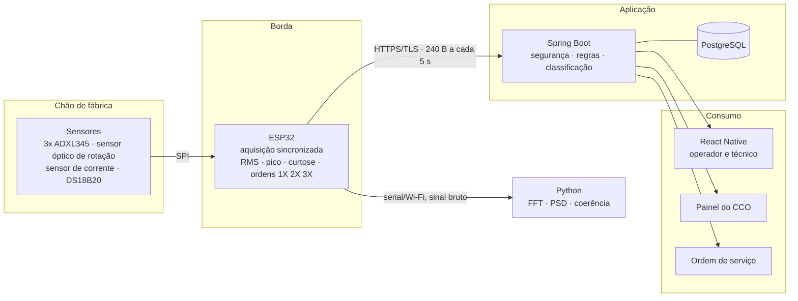
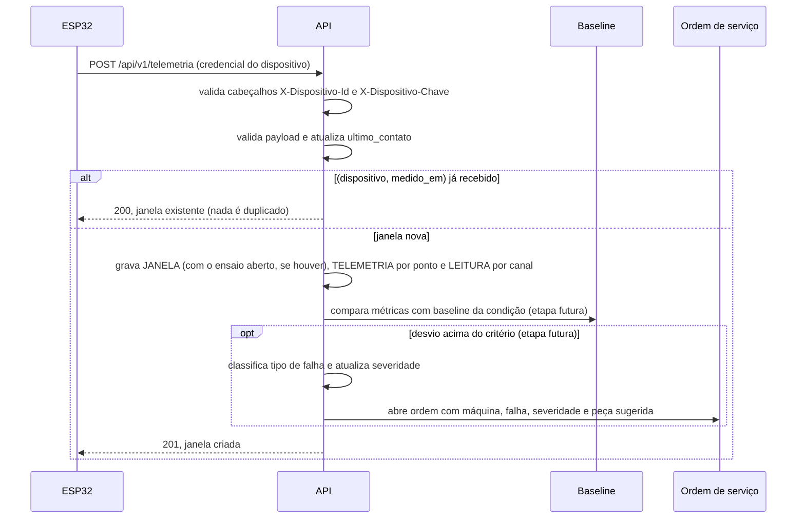

# Arquitetura — v3

Data: 10/11/2026, atualizada em 11/11/2026 (firmware de 3 sensores e modo rápido) · Versão 3 ·
telemetria agrupada em janela (ver [`der.md`](der.md)), autenticação de dispositivo por cabeçalho e
coleta rotulada por ensaio. A v2 (18/09/2026) corrigiu ESP32-S3
(inexistente no acervo) e sensores descartados (MLX90614, INMP441, BME280).

## Visão geral



## Camadas e responsabilidades

| Nível | Componente | Responsabilidade |
|---|---|---|
| 1 | Sensores | Medir. Nada além disso. |
| 2 | ESP32 | Amostrar em tempo determinístico, extrair características, transmitir |
| 3 | Enlace | Wi-Fi com TLS; buffer local cobre a queda de rede |
| 4 | Spring Boot + PostgreSQL | Autenticar, validar, comparar com baseline, classificar, abrir ordem |
| 5 | React Native e painel web | Apresentar condição e conduzir a ação |

Em operação, o dispositivo não envia forma de onda: transmite cerca de 500 bytes de JSON a cada
5 segundos, com as características já extraídas. No modo rápido, pedido por um usuário para ver a
máquina ao vivo, a janela cai para 1 s por 2 minutos. Durante ensaio, o sinal bruto vai pela serial
(quadros binários) para um notebook, sem depender de microSD ou RTC: nenhum dos dois consta no
acervo do laboratório.

## Firmware

Escrito em 11/11/2026 para 3 ADXL345 e o FC-51 num ESP32 DOIT DevKit V1; detalhes em
[`firmware.md`](firmware.md). **Compila e passa nos testes nativos, mas ainda não foi testado em
hardware.**

- **Núcleo 1, aquisição:** a cada 2 ms esvazia as FIFO dos três sensores (ODR 1600 Hz) no mesmo
  tick. Calcula em fluxo RMS, pico, curtose e as ordens por Goertzel com janela de Hann.
- **Núcleo 0, rede e interface:** Wi-Fi, NTP, a fila (RAM e LittleFS, 5 h 25 min sem rede), o
  HTTPS com verificação de certificado, a tela e os LEDs.

A aquisição nunca espera a rede.

## Organização do backend

Camadas Controller / Service / Repository, com pacotes por domínio e não por tipo técnico:

```
br.senai.predictspin
├── comum          tratamento global de exceções, respostas padronizadas, paginação
├── config         OpenAPI, CORS, Jackson, Flyway
├── seguranca      JWT, BCrypt, autenticação de dispositivo, rate limiting
├── maquina        local, máquina, ponto de medição, componente, dispositivo
├── telemetria     ingestão, consulta, baseline, ensaio
├── alerta         avaliação contra baseline, classificação, severidade acumulada
└── ordemservico   abertura automática, atribuição, ciclo de vida
```

Regra: `Controller` não conhece entidade, só DTO. `Service` concentra regra de negócio e é onde os
testes unitários batem. `Repository` não contém lógica.

## Fluxo da ingestão até a ordem de serviço



Hoje a API grava a janela e responde; a comparação com baseline, a classificação e a abertura de
ordem de serviço ainda não estão implementadas (tabelas `BASELINE`, `ALERTA` e `ORDEM_SERVICO` já
existem). O contrato do payload está em [`payload.md`](payload.md). A resposta da ingestão também é
o canal de volta para o dispositivo: enquanto a máquina estiver em modo rápido, ela traz
`modo_rapido_ate`.

A máquina nunca é bloqueada. O sistema classifica e notifica; a decisão permanece com o operador —
restrição explícita da GEOSOL e fundamento da leitura de Indústria 5.0 do projeto.

## Decisões estruturais

**Modelos de IA rodam no servidor, sobre características já extraídas na borda.** Permite iterar
sobre o modelo sem refazer firmware e mantém o dispositivo dedicado a amostrar em tempo
determinístico. Inferência embarcada fica registrada como evolução futura.

**Autenticação de dispositivo é separada da autenticação de usuário.** Telemetria forjada não causa
erro de exibição: causa decisão de manutenção errada, com custo real. Cada unidade tem credencial
própria, provisionada fora do código-fonte, e a API rejeita origem não reconhecida.

**Idempotência na ingestão.** O buffer local pode reenviar. A chave `(dispositivo_id, medido_em)` é
única na tabela `JANELA`; o reenvio responde 2xx e não duplica janela, telemetria nem leitura.

**Coleta rotulada por ensaio.** Um técnico abre um ensaio (etapa, condição, rotação alvo) na
máquina; toda janela recebida enquanto ele está aberto é gravada com esse ensaio. Só há um ensaio
aberto por máquina. Ensaio descartado é marcado, não apagado. A exportação em CSV (uma linha por
janela e ponto, com os rótulos) é o conjunto de treino da classificação. Cada linha diz o `uso`:

- `treino`: as condições de rótulo;
- `validacao`: `sensor_solto`, para conferir o alerta de instrumento, nunca como classe de treino.

A `marca` tira do treino as janelas do modo rápido e as que chegaram com menos de 98% das amostras.

**Modo rápido no banco, não em memória.** O prazo fica em `MAQUINA.modo_rapido_ate`: vale para
todos os dispositivos da máquina e sobrevive a um reinício da API. O dispositivo descobre o modo
pela resposta da ingestão, sem conexão permanente. A notificação ao painel (SSE) fica para o painel.

**Último contato com resolução de 10 s.** Gravar `DISPOSITIVO.ultimo_contato` em toda janela fazia
as ingestões concorrentes do mesmo dispositivo esperarem umas pelas outras pela trava da linha
(medição em [`teste-de-carga.md`](teste-de-carga.md)). Agora só se grava quando o valor guardado
tem mais de 10 s.

**Dado simulado é marcado como tal.** Dispositivo e ensaio têm a coluna `simulado`; o simulador
(`analise/simulador.py`) usa o dispositivo `ps-sim-01`. Consultas e exportação filtram por
`simulado`, e janela de dispositivo simulado nunca entra em ensaio real (nem o contrário).

## Ambiente

Docker Compose para banco e API no desenvolvimento. A publicação é feita no Render a partir do
`render.yaml` da raiz (serviço web em Docker e PostgreSQL gerenciado); o passo a passo está em
[`deploy-render.md`](deploy-render.md). A cada push e pull request o GitHub Actions compila a API,
roda os testes com a meta de cobertura e os testes de `analise/`. Manifests Kubernetes para a
demonstração de implantação reproduzível ainda não existem no repositório. Variáveis sensíveis por
ambiente, nunca no repositório.
