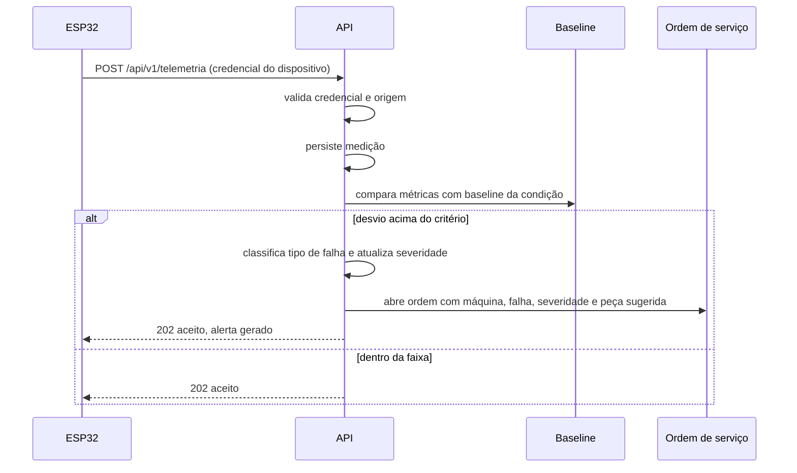

# Arquitetura — v2

Data: 18/09/2026 · Versão 2 · corrige ESP32-S3 (inexistente no acervo) e sensores descartados (MLX90614, INMP441, BME280)

## Visão geral


## Camadas e responsabilidades

| Nível | Componente | Responsabilidade |
|---|---|---|
| 1 | Sensores | Medir. Nada além disso. |
| 2 | ESP32 | Amostrar em tempo determinístico, extrair características, transmitir |
| 3 | Enlace | Wi-Fi com TLS; buffer local cobre a queda de rede |
| 4 | Spring Boot + PostgreSQL | Autenticar, validar, comparar com baseline, classificar, abrir ordem |
| 5 | React Native e painel web | Apresentar condição e conduzir a ação |

Em operação, o dispositivo não envia forma de onda: transmite cerca de 240 bytes a cada 5
segundos, com as características já extraídas. Durante ensaio, o sinal bruto é despachado por
serial ou Wi-Fi direto para um notebook, sem depender de microSD ou RTC — nenhum dos dois consta
no acervo do laboratório.

## Organização do backend

Camadas Controller / Service / Repository, com pacotes por domínio e não por tipo técnico:

```
br.senai.predictspin
├── comum          tratamento global de exceções, respostas padronizadas, paginação
├── config         OpenAPI, CORS, Jackson, Flyway
├── seguranca      JWT, BCrypt, autenticação de dispositivo, rate limiting
├── maquina        local, máquina, ponto de medição, componente, dispositivo
├── telemetria     ingestão, consulta, baseline, ensaio
├── alerta         avaliação contra baseline, classificação, severidade acumulada
└── ordemservico   abertura automática, atribuição, ciclo de vida
```

Regra: `Controller` não conhece entidade, só DTO. `Service` concentra regra de negócio e é onde os
testes unitários batem. `Repository` não contém lógica.

## Fluxo da ingestão até a ordem de serviço



A máquina nunca é bloqueada. O sistema classifica e notifica; a decisão permanece com o operador —
restrição explícita da GEOSOL e fundamento da leitura de Indústria 5.0 do projeto.

## Decisões estruturais

**Modelos de IA rodam no servidor, sobre características já extraídas na borda.** Permite iterar
sobre o modelo sem refazer firmware e mantém o dispositivo dedicado a amostrar em tempo
determinístico. Inferência embarcada fica registrada como evolução futura.

**Autenticação de dispositivo é separada da autenticação de usuário.** Telemetria forjada não causa
erro de exibição: causa decisão de manutenção errada, com custo real. Cada unidade tem credencial
própria, provisionada fora do código-fonte, e a API rejeita origem não reconhecida.

**Idempotência na ingestão.** O buffer local pode reenviar. A chave `(dispositivo_id, medido_em)` é
única; reenvio não duplica série temporal.

## Ambiente

Docker Compose para banco e API. Manifests Kubernetes versionados no repositório para a
demonstração de implantação reproduzível. Variáveis sensíveis por ambiente, nunca no repositório.
