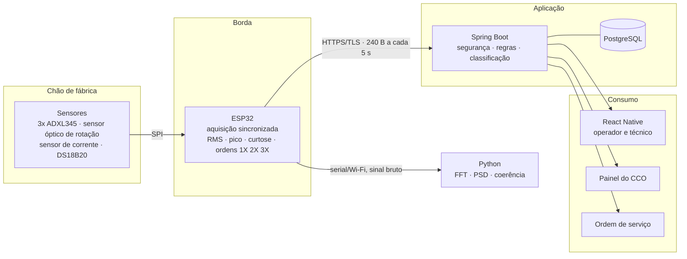
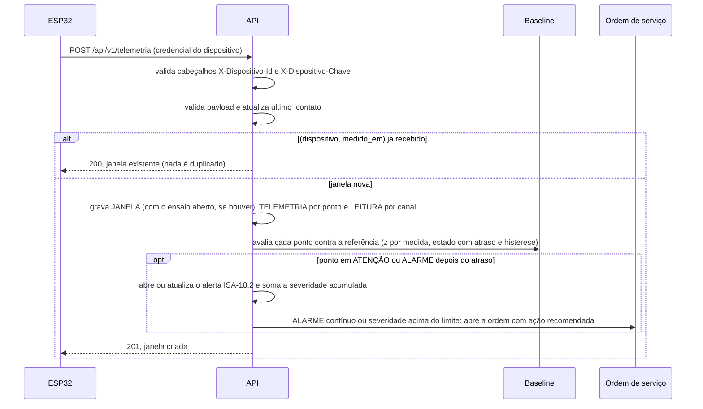
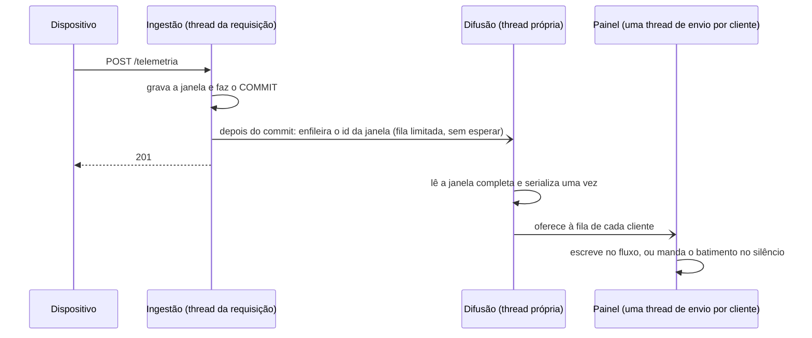

# Arquitetura — v3

Data: 10/11/2026, atualizada em 11/11/2026 (firmware de 3 sensores e modo rápido) e em 12/11/2026
(consultas do painel, eventos ao vivo e plano de coleta) e em 16/11/2026 (catálogos, receita do
ensaio, eventos marcados e painel web completo) · Versão 3 ·
telemetria agrupada em janela (ver [`der.md`](der.md)), autenticação de dispositivo por cabeçalho e
coleta rotulada por ensaio. A v2 (18/09/2026) corrigiu ESP32-S3
(inexistente no acervo) e sensores descartados (MLX90614, INMP441, BME280).

## Visão geral



## Camadas e responsabilidades

| Nível | Componente | Responsabilidade |
|---|---|---|
| 1 | Sensores | Medir. Nada além disso. |
| 2 | ESP32 | Amostrar em tempo determinístico, extrair características, transmitir |
| 3 | Enlace | Wi-Fi com TLS; buffer local cobre a queda de rede |
| 4 | Spring Boot + PostgreSQL | Autenticar, validar, comparar com baseline, classificar, abrir ordem |
| 5 | React Native e painel web | Apresentar condição e conduzir a ação |

Em operação, o dispositivo não envia forma de onda: transmite cerca de 500 bytes de JSON a cada
5 segundos, com as características já extraídas. No modo rápido, pedido por um usuário para ver a
máquina ao vivo, a janela cai para 1 s por 2 minutos. Durante ensaio, o sinal bruto vai pela serial
(quadros binários) para um notebook, sem depender de microSD ou RTC: nenhum dos dois consta no
acervo do laboratório.

## Firmware

Escrito em 11/11/2026 para 3 ADXL345 e o FC-51 num ESP32 DOIT DevKit V1; detalhes em
[`firmware.md`](firmware.md). **Compila e passa nos testes nativos, mas ainda não foi testado em
hardware.**

- **Núcleo 1, aquisição:** a cada 2 ms esvazia as FIFO dos três sensores (ODR 1600 Hz) no mesmo
  tick. Calcula em fluxo RMS, pico, curtose e as ordens por Goertzel com janela de Hann.
- **Segunda rodada (17/11/2026):** calibração de ganho e offset por sensor (comandos `cal` na serial,
  `/cal.txt` no LittleFS), velocidade RMS em mm/s por ponto, versão do firmware e calibração em cada
  janela, reenvio da fila em ritmo controlado depois de uma queda e largura do pulso do FC-51 no
  diagnóstico. Nada disso foi testado em hardware.
- **Núcleo 0, rede e interface:** Wi-Fi, NTP, a fila (RAM e LittleFS, 5 h 25 min sem rede), o
  HTTPS com verificação de certificado, a tela e os LEDs.

A aquisição nunca espera a rede.

## Organização do backend

Camadas Controller / Service / Repository, com pacotes por domínio e não por tipo técnico:

```
br.senai.predictspin
├── comum          tratamento global de exceções, respostas padronizadas, paginação
├── config         OpenAPI, CORS, Jackson, Flyway
├── seguranca      JWT, BCrypt, autenticação de dispositivo, rate limiting
├── maquina        local, máquina, ponto de medição, componente, dispositivo
├── telemetria     ingestão, consulta (janelas completas, série agregada), baseline, ensaio,
│                  receita (correção com histórico), eventos marcados, exportação CSV
├── catalogo       materiais e ferramentas (nome normalizado único, desativar sem apagar)
├── eventos        eventos ao vivo para o painel (SSE)
├── alerta         avaliação contra baseline, classificação, severidade acumulada
├── ordemservico   abertura automática, atribuição, ciclo de vida
└── ia             vetor de características, conjunto de treino, modelos (ONNX), segunda opinião, tendência
```

Regra: `Controller` não conhece entidade, só DTO. `Service` concentra regra de negócio e é onde os
testes unitários batem. `Repository` não contém lógica.

## Fluxo da ingestão até a ordem de serviço



A resposta ao dispositivo sai logo depois do commit da gravação. A avaliação contra a referência, o alerta e a
abertura de ordem de serviço rodam depois, numa fila por máquina (regra estatística em Java; detalhes em
[`alarmes.md`](alarmes.md)), e em seguida a segunda opinião do modelo ativo, que nunca muda a decisão da regra
([`ia.md`](ia.md)). Janela antiga reenviada pela fila do dispositivo é avaliada e gravada, mas não abre
alerta ao vivo nem OS. O contrato do payload está em [`payload.md`](payload.md). A resposta da ingestão também é
o canal de volta para o dispositivo: enquanto a máquina estiver em modo rápido, ela traz
`modo_rapido_ate`.

A máquina nunca é bloqueada. O sistema classifica e notifica; a decisão permanece com o operador —
restrição explícita da GEOSOL e fundamento da leitura de Indústria 5.0 do projeto.

## Decisões estruturais

**Modelos de IA rodam no servidor, sobre características já extraídas na borda.** Permite iterar
sobre o modelo sem refazer firmware e mantém o dispositivo dedicado a amostrar em tempo
determinístico. Inferência embarcada fica registrada como evolução futura.

**Autenticação de dispositivo é separada da autenticação de usuário.** Telemetria forjada não causa
erro de exibição: causa decisão de manutenção errada, com custo real. Cada unidade tem credencial
própria, provisionada fora do código-fonte, e a API rejeita origem não reconhecida.

**Idempotência na ingestão.** O buffer local pode reenviar. A chave `(dispositivo_id, medido_em)` é
única na tabela `JANELA`; o reenvio responde 2xx e não duplica janela, telemetria nem leitura.

**Coleta rotulada por ensaio.** Um técnico abre um ensaio (etapa, condição, rotação alvo) na
máquina; toda janela recebida enquanto ele está aberto é gravada com esse ensaio. Só há um ensaio
aberto por máquina. Ensaio descartado é marcado, não apagado. A exportação em CSV (uma linha por
janela e ponto, com os rótulos) é o conjunto de treino da classificação. Cada linha diz o `uso`:

- `treino`: as condições de rótulo;
- `validacao`: `sensor_solto`, para conferir o alerta de instrumento, nunca como classe de treino.

A `marca` tira do treino as janelas do modo rápido e as que chegaram com menos de 98% das amostras.

**Modo rápido no banco, não em memória.** O prazo fica em `MAQUINA.modo_rapido_ate`: vale para
todos os dispositivos da máquina e sobrevive a um reinício da API. O dispositivo descobre o modo
pela resposta da ingestão, sem conexão permanente. O painel é avisado pelo evento `modo_rapido` do
fluxo de eventos ao vivo.

**Último contato com resolução de 10 s.** Gravar `DISPOSITIVO.ultimo_contato` em toda janela fazia
as ingestões concorrentes do mesmo dispositivo esperarem umas pelas outras pela trava da linha
(medição em [`teste-de-carga.md`](teste-de-carga.md)). Agora só se grava quando o valor guardado
tem mais de 10 s.

**Plano de coleta na máquina.** `MAQUINA.rotacoes_nominais_rpm` guarda as rotações que a máquina
oferece e `MAQUINA.rotacoes_coleta_rpm` as escolhidas para a grade de cobertura
(`PUT /maquinas/{id}/coleta/plano`). A cobertura usa o plano quando a consulta não informa
rotações; com o plano vazio, continua usando as rotações dos ensaios já feitos.

**Dado simulado é marcado como tal.** Dispositivo e ensaio têm a coluna `simulado`; o simulador
(`analise/simulador.py`) usa o dispositivo `ps-sim-01`. Consultas e exportação filtram por
`simulado`, e janela de dispositivo simulado nunca entra em ensaio real (nem o contrário).

## Consultas do painel

Além da última janela e da série por ponto, o painel usa:

- **Janelas completas** (`GET /maquinas/{id}/janelas` e `GET /ensaios/{id}/janelas`): cada item traz
  o envio, os pontos e os canais. Uma página custa um número fixo de consultas (janelas, contagem,
  telemetrias de todas elas e leituras de todas elas), conferido por teste com as estatísticas do
  Hibernate.
- **Série agregada** (`GET /maquinas/{id}/serie`): o período é dividido em N intervalos iguais (até
  600) e o banco devolve, em uma consulta, média e máximo de `rms_g`, máximo de `pico_g`, média de
  curtose e das ordens por ponto, mais rotação média, número de janelas e saturação por intervalo.
  Janelas do modo rápido ficam fora. Intervalo sem janela volta vazio: é uma lacuna, nunca um valor
  interpolado. O período máximo é de 31 dias, para proteger a instância pequena de produção.

## Eventos ao vivo (SSE)

`GET /api/v1/maquinas/{id}/eventos` devolve um fluxo `text/event-stream`. O usuário se autentica
com o JWT no cabeçalho `Authorization`; token na URL é recusado (401). O parâmetro opcional
`simulado` restringe o fluxo a dado simulado ou real.

| Evento | Corpo | Quando |
|---|---|---|
| `janela` | `JanelaResposta` (o item das listagens de janelas) | janela nova gravada com `medido_em` de até 30 s atrás; reenvio (200) não gera evento |
| `recuperacao` | `RecuperacaoEvento` (`maquina_id`, `simulado`, `de`, `ate`, `quantidade`) | janelas novas com `medido_em` mais antigo que 30 s (a fila do dispositivo sendo esvaziada depois de uma queda de rede), juntadas: no máximo um evento a cada 5 s por máquina e tipo de dado |
| `ensaio` | `EnsaioEvento` (`acao`: `aberto`, `encerrado` ou `descartado`; `ensaio`: `EnsaioResposta`) | só para ADMIN e TECNICO |
| `modo_rapido` | `ModoRapidoResposta` | modo rápido ligado ou desligado; é também o primeiro evento de toda conexão, com o estado atual |
| `evento_marcado` | `EventoMarcadoResposta` | o técnico marcou um evento (pancada, cavaco, máquina vizinha, outro) no ensaio aberto; só para ADMIN e TECNICO |

O painel ignora evento de nome que não conhece (sem erro e sem derrubar a conexão): o `recuperacao`
não muda nenhuma tela. A conferência de 15 s da tela do ponto olha só os últimos 90 s com o AO VIVO
ligado; ela **não** cobre as janelas recuperadas, que aparecem nas consultas por período (tendência,
replay, exportação) quando a tela as busca de novo.



Regras do fluxo:

- **A ingestão nunca espera cliente.** O serviço só anuncia a janela nova; o anúncio é entregue
  depois do commit e apenas coloca o id numa fila limitada (256). Ler a janela do banco e escrever
  para os clientes acontece em outras threads. Sem cliente conectado na máquina, nada é feito.
- **Cliente lento ou caído é descartado.** Cada cliente tem uma fila de 64 mensagens; fila cheia ou
  falha de escrita encerra a conexão dele e libera a vaga.
- **Reenvio em massa não derruba o painel.** Depois de uma queda de rede o firmware pode ter até
  3904 janelas na fila (5 h 25 min). Se cada uma virasse um evento `janela`, a fila de 64 de cada
  painel encheria em segundos e todos seriam descartados. Por isso janela com `medido_em` mais antigo
  que **30 s** em relação ao relógio do servidor não gera `janela`: entra num acumulado da máquina, e
  no fim de cada intervalo de **5 s** sai um único evento `recuperacao` com o período (`de`, `ate`) e a
  `quantidade`. Gravação, ensaio, `ultimo_contato` e consultas não mudam; o reenvio já gravado (200)
  não gera nada. Do lado do firmware, o reenvio tem ritmo: com a janela da frente da fila mais velha
  que 30 s, espera pelo menos 250 ms entre uma resposta e o próximo envio (as 3904 janelas levam cerca
  de 16 min), e durante esse tempo o dado ao vivo do painel fica atrasado, porque as janelas novas
  entram na fila atrás das antigas.
- **Batimento.** Sem evento por 15 s, vai uma linha de comentário (`:batimento`), para o proxy não
  fechar a conexão. Os cabeçalhos `Cache-Control: no-cache` e `X-Accel-Buffering: no` impedem o
  proxy de segurar o fluxo.
- **Limites.** No máximo 4 conexões por usuário (429) e 20 no total (503), com `Retry-After` e a
  mensagem em `ErroResposta`. Cada conexão custa uma thread de envio; os padrões foram escolhidos
  para a instância de 0,1 CPU e 512 MB e mudam por `EVENTOS_MAX_POR_USUARIO` e `EVENTOS_MAX_TOTAL`.
- **Duração.** O servidor encerra cada conexão depois de 30 minutos; o cliente reconecta. No
  desligamento da API os fluxos são fechados antes da espera pelas requisições em andamento.
- **Uma instância só.** A difusão é em memória: com mais de uma instância da API, um cliente só
  veria os eventos da instância em que está conectado. Enquanto a API rodar em uma instância (como
  no Render hoje), isso basta; para escalar, a difusão teria de passar por um canal compartilhado
  (por exemplo `LISTEN/NOTIFY` do PostgreSQL).

O efeito dos clientes de eventos sobre a ingestão foi medido; os números estão em
[`teste-de-carga.md`](teste-de-carga.md#eventos-ao-vivo-e-ingestão-12112026).

## Coleta: catálogos, receita e eventos marcados

A migração `V5` (detalhes em [`der.md`](der.md)) acrescenta ao ensaio a **receita** do corte e dois
catálogos, sem mudar contrato existente (o texto livre `material` de `NovoEnsaioRequisicao` continua
aceito):

- **Catálogos** (`/api/v1/materiais`, `/api/v1/ferramentas`): o nome é guardado também normalizado
  (sem acento, caixa e pontuação) e único; criar um nome que já existe devolve 409 com o item
  existente, e o painel oferece "é esse?". ADMIN e TECNICO listam e criam; só ADMIN renomeia e
  desativa (o item desativado continua nos ensaios antigos).
- **Receita do ensaio:** material e ferramenta do catálogo, avanço, profundidade de corte, diâmetro da
  peça e fluido. `PATCH /ensaios/{id}/receita` corrige só a receita e a observação; cada campo mudado
  vira uma linha de histórico (`GET /ensaios/{id}/alteracoes`) com quem e quando. Etapa, condição,
  rotação e tempos não mudam (400 explica).
- **Eventos marcados** (`POST /ensaios/{id}/eventos`): só com o ensaio aberto, no instante do toque
  (até 2 min no futuro por diferença de relógio; antes do início, 400). Na exportação CSV, a janela
  que contém o instante e a seguinte saem com `evento_marcado` e ficam fora do treino. As colunas
  novas do CSV entram no fim, para não quebrar quem já lê o arquivo.

## Painel web

SPA estática (Vite, React 19, TypeScript estrito) que conversa só com a API pública `/api/v1`, com
cliente gerado do `openapi.json`. Leitura (L1 visão geral, L2 máquina, L3 ponto) pela norma ISA-101;
coleta pelo celular (sessão encadeada T0 → T1 → T2 → T3 guardada no navegador, cada gravação é um
ensaio na API); replay de ensaio gravado; diagnóstico. Tempo real pelo fluxo SSE acima, lido com
`fetch` (o `EventSource` não manda `Authorization`), com volta à consulta periódica quando o fluxo
cai. Alarmes e referência passam por dois adaptadores que hoje dizem "indisponível": quando a API
tiver a regra, só eles mudam. Detalhes, decisões e revisão em [`painel.md`](painel.md).

## Arquitetura segundo a ISO 13374

| Bloco da ISO 13374 | No PredictSpin | Onde | Situação |
|---|---|---|---|
| DA · Aquisição de dados | leitura sincronizada dos 3 acelerômetros e do sensor de rotação; calibração de ganho e offset por sensor; largura do pulso do FC-51 | firmware (ESP32) | 1 sensor medido em bancada (firmware antigo); firmware de 3 sensores compilado e com testes nativos, **não testado em hardware**; calibração implementada e **não testada em hardware** |
| DM · Manipulação de dados | RMS, pico, curtose, ordens 1X–3X e velocidade RMS em mm/s (10 Hz a ~800 Hz) por janela, com a versão do firmware e a calibração de cada ponto | firmware (borda) | no simulador (velocidade estimada das ordens); no firmware compilado, **não testado em hardware**; velocidade em mm/s implementada e **não testada em hardware**, sem comparação com zonas da ISO 20816 |
| SD · Detecção de estado | referência aprendida por ponto, medida, marcha, etapa e receita (mediana e 1,4826·MAD); z por medida; NORMAL, ATENÇÃO e ALARME com atraso e histerese em segundos; alerta de instrumento | API | **implementada** com dado simulado e testes; limites são proposta, a confirmar com o torno ([larmes.md](alarmes.md)) |
| HA · Avaliação de saúde | alertas no padrão ISA-18.2 (estados, prioridade, supressão), explicação, componente provável e indicadores de desempenho do alarme; segunda opinião por modelo (Isolation Forest para anomalia, Random Forest para a classe provável), treinado em Python e executado na API com ONNX Runtime ([ia.md](ia.md)) | API (regra e inferência) e Python (só treino) | **implementada**: regra estatística decide; modelo é segunda opinião, provado só com dado simulado |
| PA · Avaliação de prognóstico | tendência por ponto (Theil-Sen com intervalo de 95%) da severidade acumulada, da deriva e, com o canal habilitado, da temperatura do cabeçote, com estimativa de quando cruzaria o limite (faixa, nunca data de quebra) | API | **implementada e desabilitada por configuração** (`ps.tendencia.habilitada`), com estimativa de tendência; testada com séries sintéticas |
| AG · Geração de recomendação | ordem de serviço com ação recomendada e retorno do técnico (rótulo para o treino) | API e painel | **implementada** com dado simulado; aplicativo móvel fora do escopo |

A apresentação (ISO 13374-4) é o painel, desenhado pela ISA-101; a integração vertical do trabalho é
esse caminho do bloco DA ao AG.

## Ambiente

Docker Compose para banco e API no desenvolvimento. A publicação é feita no Render a partir do
`render.yaml` da raiz (serviço web em Docker, PostgreSQL gerenciado e o painel como site estático,
com a política de segurança gerada no build); o passo a passo está em
[`deploy-render.md`](deploy-render.md). A cada push e pull request o GitHub Actions compila a API,
roda os testes com a meta de cobertura, os testes de `analise/` e, no job `painel`, lint, tipos,
testes e build do painel. Manifests Kubernetes para a
demonstração de implantação reproduzível ainda não existem no repositório. Variáveis sensíveis por
ambiente, nunca no repositório.
