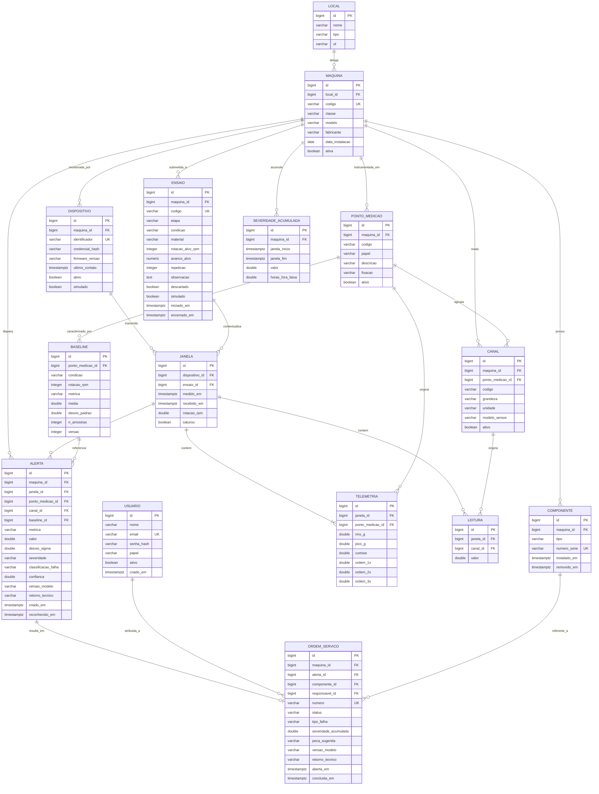

# Modelo de dados — DER v3

Data: 10/11/2026 · Versão 3 · PostgreSQL 16 · Implementado em
[`api/src/main/resources/db/migration`](../api/src/main/resources/db/migration) (Flyway)

## O que mudou da v2 para a v3

A v2 gravava uma linha de `TELEMETRIA` por ponto de medição, repetindo em cada linha o horário,
a rotação, o ensaio e as grandezas auxiliares (corrente, temperatura). Na prática o ESP32 envia
uma vez a cada 5 s um pacote com os três pontos e os canais auxiliares juntos, e a idempotência
precisa valer para o pacote inteiro, não para cada ponto. A v3 separa isso:

- **`JANELA`** é o envio: `dispositivo_id`, `ensaio_id` (opcional), `medido_em`, `recebido_em`,
  `rotacao_rpm` e `saturou`. A chave única `(dispositivo_id, medido_em)` é o que garante a
  idempotência: reenvio do buffer não duplica nada.
- **`TELEMETRIA`** fica só com as características de vibração de um ponto naquela janela
  (`rms_g`, `pico_g`, `curtose`, `ordem_1x`, `ordem_2x`, `ordem_3x`), com chave única
  `(janela_id, ponto_medicao_id)`. Rotação, horários e ensaio saíram dela.
- **`CANAL`** cadastra as grandezas auxiliares de cada máquina (temperatura do cabeçote, da
  ferramenta, ambiente, umidade, corrente), opcionalmente presas a um ponto de medição.
  **`LEITURA`** guarda o valor de cada canal em cada janela, com chave única `(janela_id, canal_id)`.
  As colunas fixas `corrente_a`, `potencia_w` e `temp_c` deixaram de existir. Rotação não é canal:
  ela define as ordens 1X/2X/3X e por isso é atributo da janela.
- **`ENSAIO`** ganhou a etapa `T0`, a coluna `condicao` (antes `condicao_ferramenta`),
  `observacao`, `descartado` e `simulado`.
- **`DISPOSITIVO`** ganhou `simulado` (padrão `false`), para separar o simulador do ESP32 real.
- **`PONTO_MEDICAO`** ganhou `codigo` (`A`, `B`, `C`), único por máquina: é a chave usada no
  payload de telemetria.
- **`ALERTA`** passa a apontar a `JANELA` e exatamente um entre ponto de medição e canal.
  `ALERTA` e `ORDEM_SERVICO` guardam `versao_modelo` (qual versão do classificador gerou o
  diagnóstico) e `retorno_tecnico` (`confirmada`, `rejeitada` ou nulo), que realimenta o modelo.
- **`ORDEM_SERVICO`** ganhou `responsavel_id` (a relação "atribuída a" usuário da v2).
- Grandezas medidas usam `double precision` em vez de `numeric`: são leituras de sensor, não
  valores monetários, e ponto flutuante de 64 bits é mais compacto e mais rápido de agregar.

## Diagrama

## Valores enumerados (restrições CHECK)

| Coluna | Valores |
|---|---|
| `maquina.classe` | `sonda`, `torno`, `furadeira`, `fresadora`, `cnc` |
| `ponto_medicao.papel` | `acionamento`, `ferramenta`, `estrutura` |
| `canal.grandeza` | `temperatura`, `umidade`, `corrente`, `tensao`, `potencia` |
| `ensaio.etapa` | `T0`, `T1`, `T2`, `T3` |
| `ensaio.condicao` | `normal`, `ferramenta_desgastada`, `avanco_excessivo`, `rotacao_inadequada` |
| `baseline.metrica` | `rms_g`, `pico_g`, `curtose`, `ordem_1x`, `ordem_2x`, `ordem_3x` |
| `alerta.severidade` | `baixa`, `media`, `alta`, `critica` |
| `alerta.retorno_tecnico`, `ordem_servico.retorno_tecnico` | `confirmada`, `rejeitada` ou nulo |
| `ordem_servico.status` | `aberta`, `em_andamento`, `concluida`, `cancelada` |
| `usuario.papel` | `ADMIN`, `TECNICO`, `OPERADOR` |

Outras restrições: `alerta` aponta exatamente um entre `ponto_medicao_id` e `canal_id`; medidas de
vibração e rotação não negativas; `usuario.email` sempre em minúsculas; períodos (`encerrado_em`,
`removido_em`, `concluida_em`) nunca anteriores ao início.

## Decisões de modelagem

**`PONTO_MEDICAO.papel` é o que generaliza entre classes de máquina; `descricao` e `fixacao` são o
que muda.** Uma furadeira e um torno compartilham os três papéis (acionamento, ferramenta,
estrutura), mas a posição física de cada um é diferente — no torno o ponto de papel "ferramenta"
fica no carro; na furadeira, no mancal do eixo-árvore. Separar papel de descrição é o que permite
consultar "todos os pontos de acionamento, de qualquer máquina" sem depender de texto livre.

**`MAQUINA.classe` substitui a suposição implícita de que só existe sonda.** A tabela de ordens
esperadas por classe (1X, 2X, passagem de dentes etc.) fica no código de análise, não no banco,
porque é regra de domínio sujeita a evoluir com a literatura.

**A janela é a unidade de envio e de idempotência.** O ESP32 extrai as características dos três
pontos sobre o mesmo trecho de sinal; gravá-las sob uma mesma janela mantém a sincronia entre
pontos explícita e permite comparar acionamento com ferramenta no mesmo instante.

**Um ensaio aberto por máquina.** Garantido por índice único parcial
`ensaio (maquina_id) WHERE encerrado_em IS NULL`. A janela recebida enquanto há ensaio aberto é
gravada com ele, desde que o ensaio e o dispositivo sejam ambos reais ou ambos simulados.

**Ensaio descartado é marcado, não apagado.** O dado continua auditável, mas sai da cobertura e
da exportação para treino.

**`simulado` em dispositivo e ensaio separa dado sintético de medição.** Toda consulta e a
exportação aceitam o filtro `simulado`, para que dado simulado nunca contamine o conjunto real.

**Baseline é por ponto de medição, não por máquina inteira.** Um ponto de acionamento e um de
estrutura têm distribuições de vibração completamente diferentes; misturá-los na mesma referência
estatística invalidaria a comparação.

**Decisões herdadas, sem alteração:** `medido_em`/`recebido_em` separados para tolerar queda de
enlace; baseline versionado; severidade acumulada como tabela, não campo calculado.

## Índices

| Índice | Consulta que atende |
|---|---|
| `janela (dispositivo_id, medido_em)` — chave única | idempotência; último contato e série por dispositivo (também em ordem decrescente) |
| `janela (medido_em DESC)` | última janela de uma máquina; série de um ponto por período |
| `janela (ensaio_id, medido_em)` parcial | resumo e exportação do conjunto de dados de um ensaio |
| `telemetria (janela_id, ponto_medicao_id)` — chave única | pontos de uma janela |
| `telemetria (ponto_medicao_id, janela_id DESC)` | série temporal de um ponto no painel |
| `leitura (janela_id, canal_id)` — chave única | canais de uma janela |
| `leitura (canal_id, janela_id DESC)` | série temporal de um canal |
| `ensaio (maquina_id) WHERE encerrado_em IS NULL` — único | no máximo um ensaio aberto por máquina |
| `ensaio (maquina_id, iniciado_em DESC)` | listagem de ensaios da máquina |
| `ensaio (maquina_id, etapa, condicao, rotacao_alvo_rpm)` | cobertura da coleta |
| `alerta (maquina_id, criado_em DESC)` | histórico de alertas por máquina |
| `alerta (severidade, reconhecido_em)` | fila do CCO, não reconhecidos primeiro |
| `ordem_servico (status, aberta_em DESC)` | painel de ordens abertas |
| `baseline (ponto_medicao_id, condicao, metrica, versao DESC)` | comparação de leitura contra referência |

## Dados iniciais

A migração `V2` cadastra o local **SENAI São Carlos (SP)**, a máquina `TORNO-01` (classe `torno`,
modelo ROMI Tormax 30), os pontos A (acionamento, cabeçote), B (ferramenta, carro) e
C (estrutura, ponta do barramento) e os canais `temp_cabecote_c`, `temp_ferramenta_c`,
`amb_temp_c`, `amb_umid_pct` e `corrente_a`. O usuário ADMIN e os dispositivos `ps-torno-01`
(real) e `ps-sim-01` (simulado) são criados na subida da API, a partir de variáveis de ambiente,
só se ainda não existirem — assim nenhuma senha ou chave fica no repositório.

## Controle de N+1

Listagens de máquina com local usam `JOIN FETCH` explícito; séries de telemetria usam projeção
direta para DTO; a última janela busca janela, pontos e canais em três consultas fixas.
`spring.jpa.open-in-view` está desligado, para que acesso preguiçoso fora da transação falhe em
desenvolvimento em vez de gerar consultas silenciosas em produção.
