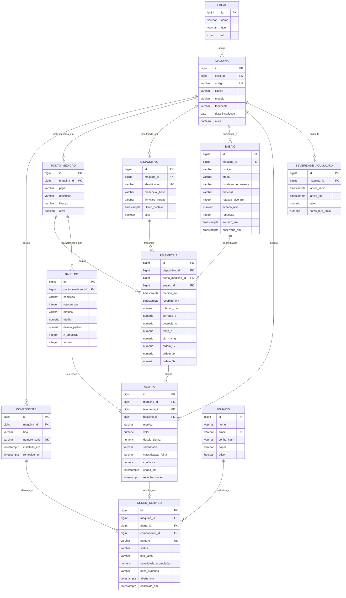

# Modelo de dados — DER v2

Data: 18/09/2026 · Versão 2 · PostgreSQL 16

## O que mudou da v1 para a v2

A v1 modelava o domínio em torno de uma única classe de ativo (sonda de perfuração), com três
colunas fixas de vibração (`vib_motor`, `vib_ferramenta`, `vib_base`) presas à tabela de
telemetria. O escopo do projeto passou a cobrir qualquer máquina rotativa industrial — torno,
furadeira, fresadora, CNC, sonda — cada uma com seu próprio arranjo de sensores. Colunas fixas não
sobrevivem a essa mudança: uma fresadora tem pontos de medição que uma furadeira não tem, e o
número de pontos varia por classe de máquina.

A v2 resolve isso com duas entidades novas — `MAQUINA`, que generaliza `SONDA`, e
`PONTO_MEDICAO`, que substitui as três colunas fixas por uma tabela. Cada ponto carrega um papel
fixo (`acionamento`, `ferramenta` ou `estrutura`) — o que generaliza entre máquinas — e uma
posição física própria — o que muda de máquina para máquina. A telemetria referencia o ponto de
medição, não mais a sonda diretamente.

## Diagrama

## Decisões de modelagem

**`PONTO_MEDICAO.papel` é o que generaliza entre classes de máquina; `descricao` e `fixacao` são o
que muda.** Uma furadeira e um torno compartilham os três papéis (acionamento, ferramenta,
estrutura), mas a posição física de cada um é diferente — no torno o ponto de papel "ferramenta"
fica no carro transversal; na furadeira, no mancal do eixo-árvore. Separar papel de descrição é o
que permite consultar "todos os pontos de acionamento, de qualquer máquina" sem depender de
texto livre.

**`MAQUINA.classe` substitui a suposição implícita de que só existe sonda.** Valores esperados:
`sonda`, `torno`, `furadeira`, `fresadora`, `cnc`. A tabela de ordens esperadas por classe (1X,
2X, passagem de dentes etc.) fica no código de análise, não no banco, porque é regra de domínio
sujeita a evoluir com a literatura.

**`telemetria.ponto_medicao_id` substitui as três colunas fixas de vibração.** Cada leitura de
sensor vira uma linha, referenciando de qual ponto ela veio. Isso também resolve o problema de uma
máquina ter mais ou menos de três pontos, caso apareça essa necessidade.

**`ensaio.etapa` registra T1/T2/T3.** `condicao_ferramenta` registra o rótulo de falha não
destrutiva (`normal`, `ferramenta_desgastada`, `avanco_excessivo`, `rotacao_inadequada`) — a
substituição de falha induzida mecânica por condição de operação controlada.

**Baseline agora é por ponto de medição, não por máquina inteira.** Um ponto de acionamento e um
de estrutura têm distribuições de vibração completamente diferentes; misturá-los na mesma
referência estatística invalidaria a comparação.

**Decisões herdadas da v1, sem alteração:** `medido_em`/`recebido_em` separados para tolerar queda
de enlace; baseline versionado; severidade acumulada como tabela, não campo calculado.

## Índices compostos

| Índice | Consulta que atende |
|---|---|
| `telemetria (ponto_medicao_id, medido_em DESC)` | série temporal de um ponto no painel |
| `telemetria (dispositivo_id, medido_em DESC)` | último contato e diagnóstico do dispositivo |
| `telemetria (ensaio_id, medido_em)` | extração do conjunto de dados de um ensaio |
| `alerta (maquina_id, criado_em DESC)` | histórico de alertas por máquina |
| `alerta (severidade, reconhecido_em)` | fila do CCO, não reconhecidos primeiro |
| `ordem_servico (status, aberta_em DESC)` | painel de ordens abertas |
| `baseline (ponto_medicao_id, condicao, metrica, versao DESC)` | comparação de leitura contra referência |

## Controle de N+1

Listagens de máquina com local, e de alerta com máquina e baseline, usam `JOIN FETCH` explícito.
`spring.jpa.open-in-view` está desligado, para que acesso preguiçoso fora da transação falhe em
desenvolvimento em vez de gerar consultas silenciosas em produção.
