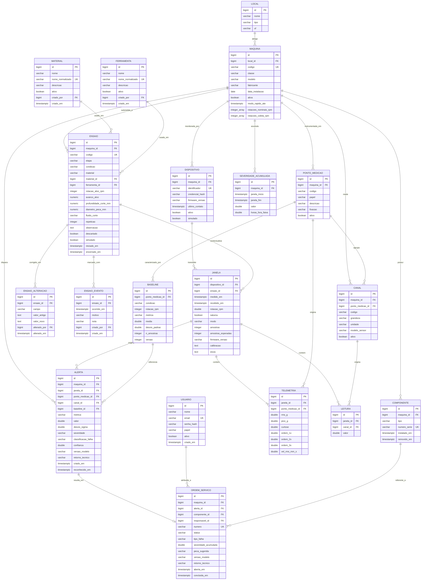

# Modelo de dados — DER v3

Data: 10/11/2026, com as migrações V3 (11/11/2026), V4 (12/11/2026), V5 (14/11/2026), V6 (17/11/2026) e V7 (18/11/2026) · PostgreSQL 16 · Implementado em
[`api/src/main/resources/db/migration`](../api/src/main/resources/db/migration) (Flyway)

## O que mudou da v2 para a v3

A v2 gravava uma linha de `TELEMETRIA` por ponto de medição, repetindo em cada linha o horário,
a rotação, o ensaio e as grandezas auxiliares (corrente, temperatura). Na prática o ESP32 envia
uma vez a cada 5 s um pacote com os três pontos e os canais auxiliares juntos, e a idempotência
precisa valer para o pacote inteiro, não para cada ponto. A v3 separa isso:

- **`JANELA`** é o envio: `dispositivo_id`, `ensaio_id` (opcional), `medido_em`, `recebido_em`,
  `rotacao_rpm` e `saturou`. A chave única `(dispositivo_id, medido_em)` é o que garante a
  idempotência: reenvio do buffer não duplica nada.
- **`TELEMETRIA`** fica só com as características de vibração de um ponto naquela janela
  (`rms_g`, `pico_g`, `curtose`, `ordem_1x`, `ordem_2x`, `ordem_3x`), com chave única
  `(janela_id, ponto_medicao_id)`. Rotação, horários e ensaio saíram dela.
- **`CANAL`** cadastra as grandezas auxiliares de cada máquina (temperatura do cabeçote, da
  ferramenta, ambiente, umidade, corrente), opcionalmente presas a um ponto de medição.
  **`LEITURA`** guarda o valor de cada canal em cada janela, com chave única `(janela_id, canal_id)`.
  As colunas fixas `corrente_a`, `potencia_w` e `temp_c` deixaram de existir. Rotação não é canal:
  ela define as ordens 1X/2X/3X e por isso é atributo da janela.
- **`ENSAIO`** ganhou a etapa `T0`, a coluna `condicao` (antes `condicao_ferramenta`),
  `observacao`, `descartado` e `simulado`.
- **`DISPOSITIVO`** ganhou `simulado` (padrão `false`), para separar o simulador do ESP32 real.
- **`PONTO_MEDICAO`** ganhou `codigo` (`A`, `B`, `C`), único por máquina: é a chave usada no
  payload de telemetria.
- **`ALERTA`** passa a apontar a `JANELA` e exatamente um entre ponto de medição e canal.
  `ALERTA` e `ORDEM_SERVICO` guardam `versao_modelo` (qual versão do classificador gerou o
  diagnóstico) e `retorno_tecnico` (`confirmada`, `rejeitada` ou nulo), que realimenta o modelo.
- **`ORDEM_SERVICO`** ganhou `responsavel_id` (a relação "atribuída a" usuário da v2).
- Grandezas medidas usam `double precision` em vez de `numeric`: são leituras de sensor, não
  valores monetários, e ponto flutuante de 64 bits é mais compacto e mais rápido de agregar.

## O que mudou com a migração V3 (11/11/2026)

A migração `V3__firmware_tres_sensores.sql` acompanha o firmware de 3 sensores, sem quebrar o envio
antigo:

- **`ENSAIO.condicao`** aceita `desbalanceamento` (classe de treino) e `sensor_solto` (ímã de um
  sensor afrouxado de propósito, para validar o alerta de instrumento). `sensor_solto` conta na
  cobertura e sai na exportação com `uso = validacao`; nunca é classe de treino.
- **`JANELA`** ganhou `modo` (`normal` ou `rapido`, padrão `normal`), `amostras` (o menor número de
  amostras lidas entre os sensores) e `amostras_esperadas`, as duas opcionais. Janela rápida ou com
  menos de 98% das amostras esperadas sai marcada na exportação (coluna `marca`), fora do treino.
- **`MAQUINA`** ganhou `modo_rapido_ate`: até quando a máquina está em modo rápido (nulo ou no
  passado = normal).

## O que mudou com a migração V4 (12/11/2026)

A migração `V4__plano_de_coleta.sql` dá à máquina o plano de coleta:

- **`MAQUINA.rotacoes_nominais_rpm`** (`integer[]`): as rotações que a máquina oferece. Para o
  `TORNO-01`: 45, 71, 90, 112, 140, 180, 224, 265, 280, 355, 450, 560, 710, 900, 1120, 1400, 1800 e
  2240 rpm, lidas da tabela da máquina. **O valor 265 ainda será conferido na placa do torno.**
- **`MAQUINA.rotacoes_coleta_rpm`** (`integer[]`): as rotações escolhidas para a grade de cobertura
  da coleta. Começa vazia; é gravada por `PUT /api/v1/maquinas/{id}/coleta/plano`, sem repetição e
  em ordem crescente.

As duas listas aparecem em `MaquinaResposta`. A cobertura (`GET .../coleta/cobertura`), quando a
consulta não informa `rotacoes`, usa o plano; se o plano estiver vazio, usa as rotações alvo dos
ensaios já feitos. O campo `origem_rotacoes` da resposta diz qual das três foi usada.

## O que mudou com a migração V5 (14/11/2026)

A migração `V5__catalogos_receita_eventos.sql` traz a receita do corte, os catálogos e os eventos
marcados durante a gravação:

- **`MATERIAL`** e **`FERRAMENTA`**: catálogos com `nome` (como exibido), `nome_normalizado`
  (minúsculas, sem acento, sem pontuação, espaços colapsados) **único**, `descricao` opcional (na
  ferramenta, por exemplo "bit de metal duro, ângulo 60°"), `ativo`, `criado_por` e `criado_em`.
  Começam vazios: a carga inicial não cria itens.
- **`ENSAIO`** ganhou a receita, toda opcional: `material_id`, `ferramenta_id`,
  `profundidade_corte_mm` (`numeric(6,3)`), `diametro_peca_mm` (`numeric(7,2)`) e `fluido_corte`
  (`seco`, `emulsao`, `oleo_integral` ou `outro`). `avanco_alvo` e `repeticao` já existiam. A coluna de
  texto `material` continua: quando o ensaio aponta um item do catálogo, ela guarda o nome dele; o
  texto que chega sem `material_id` (simulador, scripts) é procurado no catálogo pelo nome
  normalizado e, se não existir, vira item novo.
- **`ENSAIO_ALTERACAO`**: histórico das correções da receita (`campo`, `valor_antigo`, `valor_novo`,
  `alterado_por`, `alterado_em`). Etapa, condição, rotação alvo, simulado e período nunca são
  corrigidos: definem a célula da cobertura e a classe.
- **`ENSAIO_EVENTO`**: instante (`ocorrido_em`) em que algo fora do plano aconteceu num ensaio aberto,
  com `motivo` (`pancada`, `cavaco`, `maquina_vizinha` ou `outro`), `nota` opcional e `criado_por`.
  Na exportação, as janelas que contêm o instante e a seguinte saem com `evento_marcado = true`.

## O que mudou com a migração V6 (17/11/2026)

A migração `V6__rastreabilidade_e_velocidade.sql` acompanha a segunda rodada do firmware, sem quebrar
o envio antigo (tudo anulável; janelas anteriores ficam com nulo):

- **`TELEMETRIA.vel_rms_mm_s`** (`double precision`, ≥ 0 por CHECK): velocidade RMS do ponto em
  mm/s, calculada no dispositivo (no firmware, banda de 10 Hz a ~800 Hz; no simulador, estimada das
  ordens).
- **`JANELA.firmware_versao`** (`varchar(40)`): versão do firmware que mediu a janela.
- **`JANELA.calibracao`** e **`JANELA.eixos`** (`text`): identificador da calibração e eixo de
  análise de cada ponto, em JSON compacto com os pontos em ordem
  (`{"A":"A-20261117T143200Z","B":"nominal"}` e `{"A":"z","B":"z"}`). Ficam na janela, e não em
  `TELEMETRIA`, porque chegam num objeto só por envio; a exportação abre o valor do ponto de cada
  linha com o operador `->>` do PostgreSQL.

## O que mudou com a migração V7 (18/11/2026)

A migração `V7__referencia_alarme_os.sql` traz a referência aprendida, a avaliação de cada janela, os alertas
no padrão ISA-18.2 e a ordem de serviço (parte A da inteligência). A tabela `BASELINE` da V1 nunca foi
usada e fica como está; a referência vive em tabelas novas. Todos os limites numéricos ficam em
`application.yml` (`ps.referencia`, `ps.alarme`, `ps.os`), não no banco.

- **`REFERENCIA_VERSAO`** (máquina, `simulado`, número, data, autor, janelas usadas e de deriva, excluídas por
  motivo em `jsonb`, parâmetros em `jsonb`): versão imutável; a anterior fica guardada.
- **`REFERENCIA_CELULA`** (versão, ponto, medida, marcha, etapa T0, T1 ou T3, receita opcional por
  `material_id` e `ferramenta_id`, n, mediana, σ = 1,4826·MAD, p95, piso de ruído, σ efetivo, suficiente,
  calibração e versões de firmware das janelas usadas).
- **`AVALIACAO`** (chave `janela_id` + `ponto_medicao_id`): uma linha por janela e ponto, com a situação, o
  estado, a etapa da referência, a marca de genérica e o z de cada medida em `real` (67 bytes por linha, medido).
- **`ESTADO_PONTO`** (chave ponto + `simulado`): memória da regra (atraso, histerese, instrumento, severidade
  desde a última OS); uma linha por ponto, atualizada, não cresce.
- **`SEVERIDADE_ACUMULADA`** ganha `ponto_medicao_id` e `simulado` (soma em z·s por ponto e dia).
- **`COMPONENTE`** ganha `ponto_medicao_id` (componente provável de cada ponto, semeado) e nasce
  **`ACAO_RECOMENDADA`** (texto por tipo, papel do ponto e medida dominante).
- **`ALERTA`** ganha tipo (máquina ou instrumento), estado ISA-18.2, nível atual e pior, z, explicação, ação,
  componente, versão da referência, firmware, calibração, ensaio e condição, `simulado`, reconhecimento,
  normalização, encerramento e supressão; um índice único permite um alerta em aberto por ponto, tipo e tipo de
  dado. **`ALERTA_HISTORICO`** guarda cada mudança de estado.
- **`ORDEM_SERVICO`** ganha ponto, motivo de abertura, explicação, ação, versões, `simulado`, assumida em e
  comentário do técnico; um índice único permite uma OS aberta por ponto e tipo de dado.

## Diagrama

## Valores enumerados (restrições CHECK)

| Coluna | Valores |
|---|---|
| `maquina.classe` | `sonda`, `torno`, `furadeira`, `fresadora`, `cnc` |
| `ponto_medicao.papel` | `acionamento`, `ferramenta`, `estrutura` |
| `canal.grandeza` | `temperatura`, `umidade`, `corrente`, `tensao`, `potencia` |
| `ensaio.etapa` | `T0`, `T1`, `T2`, `T3` |
| `ensaio.condicao` | treino: `normal`, `ferramenta_desgastada`, `avanco_excessivo`, `rotacao_inadequada`, `desbalanceamento`; validação: `sensor_solto` |
| `ensaio.fluido_corte` | `seco`, `emulsao`, `oleo_integral`, `outro` (ou nulo) |
| `ensaio_evento.motivo` | `pancada`, `cavaco`, `maquina_vizinha`, `outro` |
| `janela.modo` | `normal`, `rapido` |
| `baseline.metrica` | `rms_g`, `pico_g`, `curtose`, `ordem_1x`, `ordem_2x`, `ordem_3x` |
| `alerta.severidade` | `baixa`, `media`, `alta`, `critica` |
| `alerta.retorno_tecnico`, `ordem_servico.retorno_tecnico` | `confirmada`, `rejeitada` ou nulo |
| `ordem_servico.status` | `aberta`, `em_andamento`, `concluida`, `cancelada` |
| `usuario.papel` | `ADMIN`, `TECNICO`, `OPERADOR` |

Outras restrições: `alerta` aponta exatamente um entre `ponto_medicao_id` e `canal_id`; medidas de
vibração e rotação não negativas; `usuario.email` sempre em minúsculas; períodos (`encerrado_em`,
`removido_em`, `concluida_em`) nunca anteriores ao início.

## Decisões de modelagem

**`PONTO_MEDICAO.papel` é o que generaliza entre classes de máquina; `descricao` e `fixacao` são o
que muda.** Uma furadeira e um torno compartilham os três papéis (acionamento, ferramenta,
estrutura), mas a posição física de cada um é diferente — no torno o ponto de papel "ferramenta"
fica no carro; na furadeira, no mancal do eixo-árvore. Separar papel de descrição é o que permite
consultar "todos os pontos de acionamento, de qualquer máquina" sem depender de texto livre.

**`MAQUINA.classe` substitui a suposição implícita de que só existe sonda.** A tabela de ordens
esperadas por classe (1X, 2X, passagem de dentes etc.) fica no código de análise, não no banco,
porque é regra de domínio sujeita a evoluir com a literatura.

**A janela é a unidade de envio e de idempotência.** O ESP32 extrai as características dos três
pontos sobre o mesmo trecho de sinal; gravá-las sob uma mesma janela mantém a sincronia entre
pontos explícita e permite comparar acionamento com ferramenta no mesmo instante.

**Um ensaio aberto por máquina.** Garantido por índice único parcial
`ensaio (maquina_id) WHERE encerrado_em IS NULL`. A janela recebida enquanto há ensaio aberto é
gravada com ele, desde que o ensaio e o dispositivo sejam ambos reais ou ambos simulados.

**Ensaio descartado é marcado, não apagado.** O dado continua auditável, mas sai da cobertura e
da exportação para treino.

**`simulado` em dispositivo e ensaio separa dado sintético de medição.** Toda consulta e a
exportação aceitam o filtro `simulado`, para que dado simulado nunca contamine o conjunto real.

**Baseline é por ponto de medição, não por máquina inteira.** Um ponto de acionamento e um de
estrutura têm distribuições de vibração completamente diferentes; misturá-los na mesma referência
estatística invalidaria a comparação.

**Decisões herdadas, sem alteração:** `medido_em`/`recebido_em` separados para tolerar queda de
enlace; baseline versionado; severidade acumulada como tabela, não campo calculado.

## Índices

| Índice | Consulta que atende |
|---|---|
| `janela (dispositivo_id, medido_em)` — chave única | idempotência; último contato e série por dispositivo (também em ordem decrescente) |
| `janela (medido_em DESC)` | última janela de uma máquina; série de um ponto por período |
| `janela (ensaio_id, medido_em)` parcial | resumo e exportação do conjunto de dados de um ensaio |
| `telemetria (janela_id, ponto_medicao_id)` — chave única | pontos de uma janela |
| `telemetria (ponto_medicao_id, janela_id DESC)` | série temporal de um ponto no painel |
| `leitura (janela_id, canal_id)` — chave única | canais de uma janela |
| `leitura (canal_id, janela_id DESC)` | série temporal de um canal |
| `ensaio (maquina_id) WHERE encerrado_em IS NULL` — único | no máximo um ensaio aberto por máquina |
| `ensaio (maquina_id, iniciado_em DESC)` | listagem de ensaios da máquina |
| `ensaio (maquina_id, etapa, condicao, rotacao_alvo_rpm)` | cobertura da coleta |
| `material (nome_normalizado)`, `ferramenta (nome_normalizado)` — únicos | um nome por item, ignorando maiúsculas, acentos e pontuação |
| `ensaio (material_id)`, `ensaio (ferramenta_id)` parciais | filtro da lista de ensaios por material e ferramenta |
| `ensaio_alteracao (ensaio_id, alterado_em)` | histórico de correções de um ensaio |
| `ensaio_evento (ensaio_id, ocorrido_em)` | eventos de um ensaio; marca das janelas na exportação |
| `alerta (maquina_id, criado_em DESC)` | histórico de alertas por máquina |
| `alerta (severidade, reconhecido_em)` | fila do CCO, não reconhecidos primeiro |
| `ordem_servico (status, aberta_em DESC)` | painel de ordens abertas |
| `baseline (ponto_medicao_id, condicao, metrica, versao DESC)` | comparação de leitura contra referência |

## Dados iniciais

A migração `V2` cadastra o local **SENAI São Carlos (SP)**, a máquina `TORNO-01` (classe `torno`,
modelo ROMI Tormax 30), os pontos A (acionamento, cabeçote), B (ferramenta, carro) e
C (estrutura, ponta do barramento) e os canais `temp_cabecote_c`, `temp_ferramenta_c`,
`amb_temp_c`, `amb_umid_pct` e `corrente_a`. O usuário ADMIN e os dispositivos `ps-torno-01`
(real) e `ps-sim-01` (simulado) são criados na subida da API, a partir de variáveis de ambiente,
só se ainda não existirem — assim nenhuma senha ou chave fica no repositório.

## Controle de N+1

Listagens de máquina com local usam `JOIN FETCH` explícito; séries de telemetria usam projeção
direta para DTO; a última janela busca janela, pontos e canais em três consultas fixas. As
listagens de janelas completas buscam as telemetrias e as leituras de toda a página de uma vez
(`IN` dos ids), e um teste confere que o número de comandos é o mesmo com 3 ou com 40 janelas. A
série agregada é uma única consulta SQL.
`spring.jpa.open-in-view` está desligado, para que acesso preguiçoso fora da transação falhe em
desenvolvimento em vez de gerar consultas silenciosas em produção.
